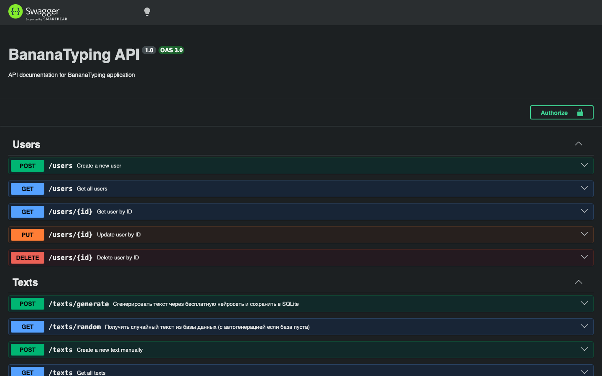

# 🍌 BananaTyping

> **Современный веб-тренажер слепой печати** с генерацией текстов через бесплатную нейросеть, базой данных на SQLite3, адаптивным интерфейсом и соревновательным лидербордом.


---

## 📸 Скриншоты интерфейса

### 1. Режим тренировки (Генератор ИИ + Виртуальная клавиатура + SQLite)
> Интерактивный набор с замером скорости WPM, точности, индикатором пробела `␣`, отслеживанием дефисов/тире и выбором тем.


### 2. Главная страница (Hero + Превью тренажера + Лидерборд)
> Адаптивная главная страница с динамическими виджетами и быстрыми переходами.


### 3. Авторизация и безопасность (JWT)
> Вход и регистрация пользователей с сохранением личной статистики заездов.


### 4. Документация API (NestJS Swagger / OpenAPI)
> Полнофункциональный REST API со встроенной документацией и песочницей на `/api`.



---

## 🚀 О проекте

**BananaTyping** — это полнофункциональное клиент-серверное веб-приложение для тренировки навыков десятипальцевой слепой печати. Приложение сочетает современный отзывчивый интерфейс, интерактивную клавиатуру и алгоритмы генерации текстов на базе искусственного интеллекта.

### ✨ Ключевые возможности:

* 🤖 **Генерация текстов через бесплатную нейросеть (AI):**
  * Интеграция с **Pollinations AI** (доступ к моделям GPT / Llama без необходимости регистрации и API-ключей).
  * Выбор темы текстов: *«🍌 Бананы и юмор»*, *«💻 IT и код»*, *«🚀 Космос и наука»*, *«💡 Цитаты»* или случайная тема.
  * Регулировка желаемой длины (*короткий*, *средний*, *длинный*) и сложности.
  * Автоматический **Smart Offline Fallback**: если сеть недоступна, приложение использует встроенный локальный генератор и никогда не выдает ошибку.
* 💾 **База данных на SQLite3:**
  * Все сгенерированные нейросетью тексты автоматически сохраняются в локальную базу данных SQLite (`banana_typing.sqlite`).
  * Встроенная библиотека текстов с поиском и возможностью выбрать любой сохраненный текст для повторной тренировки.
  * Автоматический посев (seeding) стартовых текстов на русском и английском языках при первом запуске.
* ⌨️ **Умная интерактивная клавиатура:**
  * Поддержка русской и английской раскладок с плавной адаптацией под любые экраны.
  * **Отслеживание тире и дефисов:** поддержка всех вариантов Unicode (`-`, `—`, `–`, `−`) через стандартную клавишу `-`.
  * Наглядная индикация пробела знаком `␣` с пульсирующим курсором.
  * Подсветка ожидаемой клавиши, анимация ошибок и успешного набора.
* 📊 **Метрики в реальном времени:**
  * Мгновенный расчет скорости печати в словах в минуту (**WPM**).
  * Процент точности (**Accuracy**) и секундомер заезда.
* 🏆 **Личный кабинет и Лидерборд:**
  * Регистрация и авторизация на базе **JWT-токенов** и хэширования паролей (Bcrypt).
  * История персональных тренировок в личном кабинете.
  * Глобальная таблица лидеров дня с возможностью соревноваться с другими игроками.
* 📱 **100% Адаптивный дизайн:**
  * Полная адаптивность под любые устройства: смартфоны (от 320px), планшеты, ноутбуки и широкоформатные мониторы.

---

## 🛠 Стек технологий

| Область | Технологии |
|---|---|
| **Frontend** | React 18, TypeScript, Vite, Tailwind CSS 4, Zustand, Lucide Icons, Recharts, Motion |
| **Backend** | NestJS 11, TypeORM, SQLite3, Passport.js, JWT, Class Validator, Swagger (OpenAPI) |
| **AI / Neural Network** | Pollinations AI (GPT/Llama API), опционально Google Gemini API |
| **DevOps / Deploy** | Docker, Docker Compose, Nginx, Alpine Linux |

---

## 📁 Структура проекта

```text
BananaTyping/
├── client/                     # Фронтенд на React + Vite
│   ├── src/
│   │   ├── app/
│   │   │   ├── components/     # Компоненты интерфейса (Header, Footer, Widgets)
│   │   │   │   └── training/   # Клавиатура, AI-панель, модальное окно SQLite
│   │   │   ├── pages/          # Страницы (Home, Training, Profile, Login, Register)
│   │   │   ├── stores/         # Zustand-сторы (userStore, leaderboardStore, textStore)
│   │   │   └── utils/          # Утилиты (сопоставление символов, тире/дефисов)
│   │   ├── client/             # Автогенерированные API-типы и SDK
│   │   └── main.tsx            # Точка входа React
│   ├── Dockerfile              # Dockerfile для сборки и раздачи фронтенда через Nginx
│   └── nginx.conf              # Nginx конфигурация для SPA
├── server/                     # Бэкенд на NestJS
│   ├── src/
│   │   ├── auth/               # Модуль авторизации (JWT, регистрация, вход)
│   │   ├── database/           # Подключение SQLite TypeORM и сущности (User, Text, Leaderboard)
│   │   ├── texts/              # Работа с текстами и сервис AI-генерации (AiTextService)
│   │   ├── leaderboards/       # Таблица лидеров и сохранение результатов
│   │   ├── users/              # Модуль пользователей
│   │   └── main.ts             # Запуск NestJS, Swagger и CORS
│   └── Dockerfile              # Dockerfile для бэкенда (Node.js 22 + SQLite3)
├── docker-compose.yml          # Запуск всего проекта в Docker контейнерах
├── nginx.conf.example          # Пример боевого Nginx конфига для домена с SSL
└── README.md                   # Документация проекта
```

---

## 🏁 Быстрый старт (Локальная разработка)

### Предварительные требования

* [Node.js](https://nodejs.org/) версии **20.x** или **22.x**
* Менеджер пакетов **npm**

---

### 1. Настройка и запуск бэкенда (`server`)

1. Перейдите в каталог сервера:
   ```bash
   cd server
   ```

2. Установите зависимости:
   ```bash
   npm install
   ```

3. Создайте файл `.env` на основе примера:
   ```bash
   cp .env.example .env
   ```
   *Содержимое `.env`:*
   ```env
   PORT=3000
   DB_DATABASE=banana_typing.sqlite
   JWT_SECRET=super-secret-jwt-key-change-in-production
   CORS_ORIGIN=http://localhost:5173,http://localhost:3000
   AI_PROVIDER=pollinations
   ```

4. Запустите бэкенд в режиме разработки:
   ```bash
   npm run start:dev
   ```
   * Сервер запустится на `http://localhost:3000`
   * Документация Swagger (OpenAPI) доступна по адресу `http://localhost:3000/api`
   * Файл базы данных `banana_typing.sqlite` создается и наполняется автоматически при первом старте.

---

### 2. Настройка и запуск фронтенда (`client`)

1. В отдельном терминале перейдите в каталог клиента:
   ```bash
   cd client
   ```

2. Установите зависимости:
   ```bash
   npm install
   ```

3. Запустите сервер разработки:
   ```bash
   npm run dev
   ```
   * Клиент откроется по адресу `http://localhost:5173`

---

## 🐳 Развертывание в продакшене (Docker Compose)

Проект полностью готов к развертыванию на VPS/VDS сервере с собственным доменом.

1. Склонируйте проект на сервер:
   ```bash
   git clone <URL_РЕПОЗИТОРИЯ> /var/www/BananaTyping
   cd /var/www/BananaTyping
   ```

2. Настройте боевой `.env` в папке `server/`:
   ```bash
   cp server/.env.example server/.env
   # Отредактируйте CORS_ORIGIN, указав ваш домен:
   # CORS_ORIGIN=https://ваш-домен.ru,https://www.ваш-домен.ru
   ```

3. Запустите проект одной командой:
   ```bash
   docker compose up -d --build
   ```
   * База данных SQLite сохраняется в постоянном Docker-томе (`sqlite_data`) и не теряется при перезапусках.
   * Фронтенд слушает порт `80`, бэкенд — порт `3000`.

4. **Настройка домена и SSL:**
   Для проксирования и подключения бесплатного SSL-сертификата Let's Encrypt используйте готовый шаблон [nginx.conf.example](nginx.conf.example):
   ```bash
   sudo cp nginx.conf.example /etc/nginx/sites-available/bananatyping
   # Замените your-domain.com на ваш домен и выполните:
   sudo certbot --nginx -d ваш-домен.ru
   ```

---

## 📡 Основные API-эндпоинты

| Метод | Эндпоинт | Описание |
|---|---|---|
| `POST` | `/texts/generate` | Генерация нового текста через нейросеть с сохранением в SQLite |
| `GET` | `/texts/random?language=ru` | Получение случайного текста из базы (или автогенерация) |
| `GET` | `/texts?language=ru` | Получение списка всех сохраненных текстов |
| `POST` | `/auth/register` | Регистрация нового пользователя |
| `POST` | `/auth/login` | Вход и получение JWT-токена |
| `GET` | `/leaderboards` | Получение глобального рейтинга лидеров дня |
| `POST` | `/leaderboards` | Сохранение результата заезда (WPM, точность, время) |
| `GET` | `/leaderboards/user/:id` | Получение персональной истории заездов пользователя |

Интерактивная песочница и детальное описание параметров доступны в Swagger: `http://localhost:3000/api`.

---

## 📄 Лицензия

Проект распространяется под лицензией **MIT**. Вы можете свободно модифицировать и использовать его в учебных и коммерческих целях.
